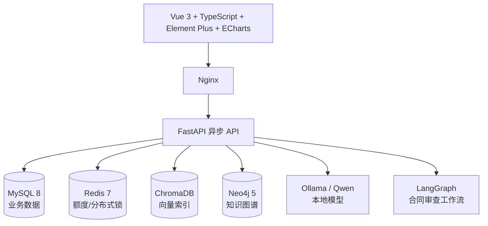

# 智法通｜企业级智能法律顾问平台

## 面试官速览

| 关注点 | 项目实现 |
| --- | --- |
| 解决的问题 | 将企业法律问答、合同初审和内部资料检索集中到一个可追溯的工作台。 |
| 核心链路 | 问答采用混合检索、融合与重排后生成带引用的回答；合同审查由 LangGraph 编排多阶段检查。 |
| 技术重点 | FastAPI + Vue 3；ChromaDB、MySQL、Redis、Neo4j 与本地 Ollama 模型；Docker Compose 部署。 |
| 阅读入口 | [RAG 管线](backend/app/rag/pipeline.py)、[合同审查工作流](backend/app/agent/workflow.py)、[面试实现说明](docs/智法通_面试项目介绍与实现说明.md)。 |
| 适用边界 | 仓库内法条和案例为本地演示样例，输出只用于辅助检索与初审，不替代律师意见。 |


> 面向企业法务与业务人员的本地化 AI 法律工作台：法律问答、合同审查、知识库检索、法律知识图谱与数据分析。

## 项目简介

智法通将法规、案例样例和企业上传文档组织为可检索知识库。用户提出法律问题时，系统通过 RAG 检索增强生成回答，并返回参考引用与置信度；上传合同后，系统使用 LangGraph 编排的多阶段审查工作流识别风险条款、生成修改建议和审查报告。

本项目定位为辅助企业法务提升检索、初筛和文档处理效率，**不替代律师出具正式法律意见**。

## 核心能力

- 智能法律问答：多轮会话、SSE 流式回答、引用展示、置信度评估与用户反馈。
- RAG 混合检索：查询改写、子问题分解、向量召回、BM25、RRF 融合、Cross-Encoder 精排与低置信度重检索。
- 合同智能审查：PDF/Word/TXT 上传解析、条款拆分、完整性/风险/合规/一致性检查、反方 Agent 质疑与辩论记录。
- 法律知识库：法规、案例与企业文档上传、分块、向量化、语义检索和文档状态管理。
- 法律知识图谱：构建“法律—法条—案例—概念”关系网络，支持 Neo4j 持久化和内存降级。
- 企业工作台：概览、趋势、领域分布、活动流、热点问题、引用统计和用户行为分析。
- 安全与权限：JWT、RBAC、文件白名单与 MIME 校验、额度限制、模型输出双层 XSS 清洗。

## 技术架构



| 分类 | 技术选型 |
| --- | --- |
| 前端 | Vue 3、TypeScript、Vite、Pinia、Vue Router、Axios、Element Plus、ECharts |
| 后端 | FastAPI、Pydantic、SQLAlchemy Async、httpx |
| AI | Ollama/Qwen、RAG、ChromaDB、BM25、RRF、Cross-Encoder Reranker、LangGraph |
| 数据 | MySQL 8、Redis 7、Neo4j 5、ChromaDB |
| 文档解析 | PyMuPDF、pdfplumber、python-docx |
| 部署 | Docker Compose、Nginx 多阶段镜像 |

## 快速启动

### 环境要求

- Docker Desktop / Docker Compose
- 可选：本地 Ollama。项目默认使用 `qwen2.5:7b-instruct-q4_K_M`；没有模型服务时，部分向量能力会降级，但完整 AI 问答与审查需要可用的 Ollama。

### 启动服务

```bash
docker compose up -d --build
```

默认端口可通过根目录 `.env` 覆盖：

| 服务 | 默认宿主机端口 |
| --- | --- |
| 前端 | `8080`（本地环境可配置为 `8188`） |
| 后端 API | `8000` |
| MySQL | `13306` |
| Redis | `16379` |
| Neo4j Browser | `17474` |

启动后访问前端地址，例如 `http://127.0.0.1:8080`；后端 Swagger 文档为 `http://127.0.0.1:8000/docs`。

查看运行状态：

```bash
docker compose ps
```

停止服务：

```bash
docker compose down
```

> 请不要使用 `docker compose down -v`，该命令会移除数据库、上传文件和向量索引卷。

## 演示账号

首次启动会以幂等方式初始化角色、示例用户、法规文档和欢迎通知。

| 账号 | 密码 | 角色 | 权限范围 |
| --- | --- | --- | --- |
| `admin` | `admin123` | 超级管理员 | 全部功能、用户管理 |
| `lawyer` | `lawyer123` | 法务负责人 | 业务功能、仪表盘、数据分析 |
| `user` | `user123456` | 普通用户 | 问答、合同审查、知识库 |

仅用于本地演示。生产环境请通过环境变量管理密钥，并在首次登录后修改或移除示例账号。

## RAG 问答流程

```text
用户问题
  → 指代消解 / 查询改写 / 复杂问题拆分
  → Chroma 向量召回 + BM25 稀疏召回
  → RRF 融合粗排 → Cross-Encoder 精排
  → 组装证据上下文 → Ollama 流式生成回答
  → 置信度评估；低置信度则扩大召回范围重检索
  → 引用校验、XSS 清洗、免责声明、会话持久化
```

## 合同审查流程

```text
上传并校验文件 → 文本解析 → LangGraph 工作流
→ 条款拆分
→ 完整性检查 + 条款分类
→ 风险识别
→ 合规检查 + 一致性检查
→ 反方 Agent 质疑 → 审查辩论
→ 风险评分 → 修改建议 → 审查报告 / 优化文本
```

上传接口限制 PDF、DOCX、DOC、TXT 格式，并执行文件名路径遍历、扩展名、大小和 MIME 一致性校验。

## 数据说明

仓库内置的法规摘录用于本地演示与检索；法条、案例工具还定义了外部 JSON 数据文件路径：

- 种子法规摘录在 [`backend/app/init_data.py`](backend/app/init_data.py)。
- [`law_search.py`](backend/app/mcp_servers/law_search.py) 和 [`case_search.py`](backend/app/mcp_servers/case_search.py) 读取各自的 `data/` JSON 文件；当前仓库未提交该目录，缺少文件时工具返回空数据。
- 企业私有知识可通过知识库页面上传并写入 MySQL、上传卷和 ChromaDB。

当前提交未包含法条与案例 JSON 数据文件；种子法规摘录也只是本地演示材料，不应表述为完整或实时更新的权威生产数据集。生产化需接入具备授权、来源、版本、生效状态和更新机制的数据源。

## 项目结构

```text
├── frontend/                 # Vue 3 前端
│   └── src/
│       ├── api/              # Axios API 封装
│       ├── components/       # 通用组件
│       ├── router/           # 认证与角色路由守卫
│       ├── stores/           # Pinia 状态
│       └── views/            # 仪表盘、问答、合同、知识库等页面
├── backend/                  # FastAPI 后端
│   └── app/
│       ├── api/              # REST/SSE 路由
│       ├── agent/            # LangGraph 合同审查节点与工作流
│       ├── rag/              # 检索、Embedding、重排与生成管线
│       ├── services/         # 领域服务
│       ├── models/           # SQLAlchemy 模型
│       └── mcp_servers/      # 法条、案例等工具服务及样例数据
├── sql/                      # MySQL 初始化脚本
├── docs/                     # 项目文档
└── docker-compose.yml        # 本地编排入口
```

## 文档与阅读路径

- [面试项目介绍与实现说明](docs/智法通_面试项目介绍与实现说明.md)：数据来源、模块实现、端到端流程、技术亮点和面试话术。
- [`backend/app/main.py`](backend/app/main.py)：应用生命周期、路由注册、索引与图谱初始化。
- [`backend/app/rag/pipeline.py`](backend/app/rag/pipeline.py)：RAG 全流程。
- [`backend/app/agent/workflow.py`](backend/app/agent/workflow.py)：合同审查状态图。
- [`frontend/src/router/index.ts`](frontend/src/router/index.ts)：前端鉴权和角色路由。

## 后续演进方向

- 以租户、部门、密级为维度的文档 ACL 与向量检索权限过滤。
- 使用异步任务队列承载批量 embedding、合同审查和大文件解析。
- 建立 RAG 评测集，持续度量召回率、引用正确率、人工采纳率和 P95 时延。
- 接入合法授权的法规/案例数据源，建立版本化与增量更新管线。
- 接入 Secret 管理、审计日志、对象存储和生产级监控告警。

## License

本项目用于学习、演示和技术交流。接入真实法律数据或投入生产使用前，请自行完成数据授权、隐私保护和合规评估。
