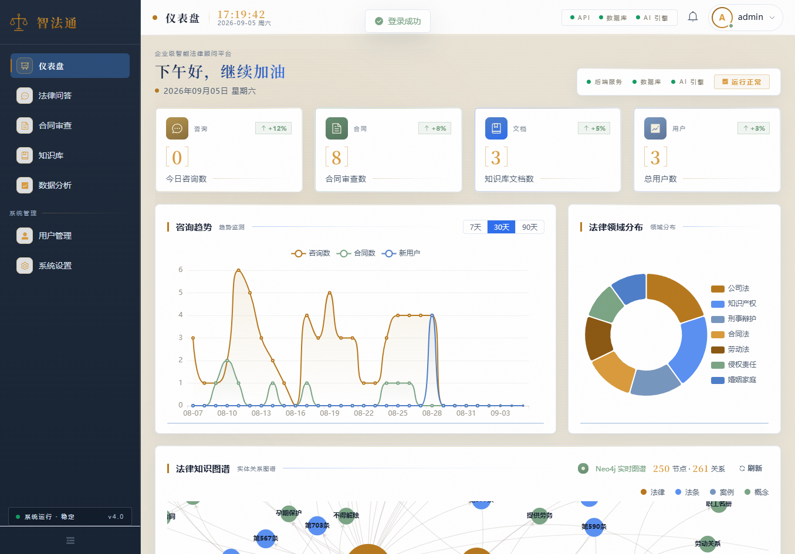
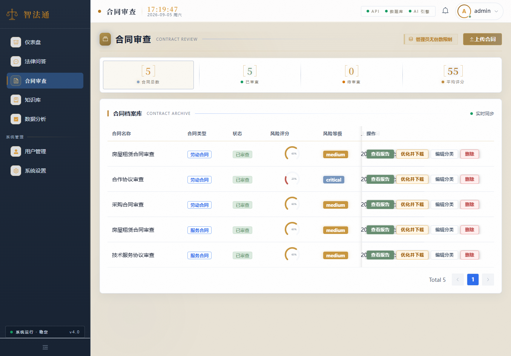
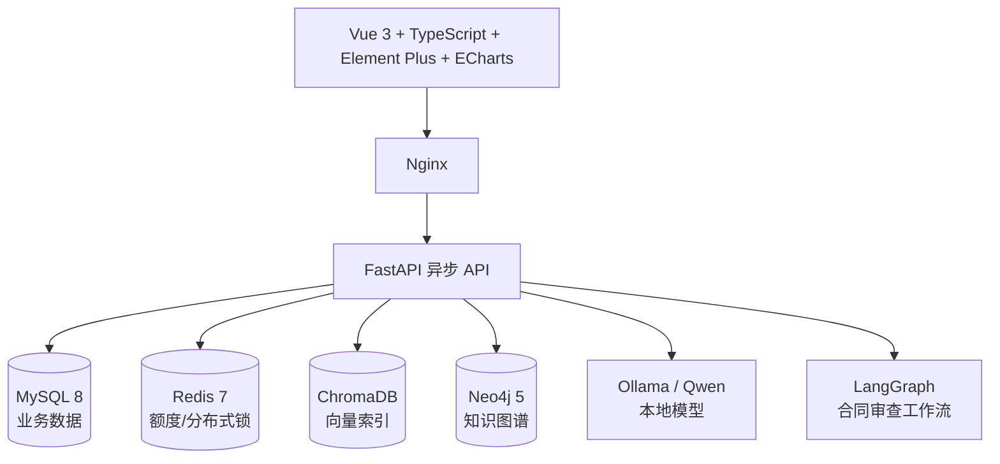

# 智法通｜企业级智能法律顾问平台

智法通面向企业法务和业务人员，把**法律问答、合同初审和企业文档检索**放在同一个工作台。用户提问时可以查看回答引用；上传合同后可以查看风险条款、修改建议和审查报告。系统提供法律信息检索和合同初步审查能力。

## 用户可以完成什么

- **提出法律问题**：系统从知识库检索相关内容，生成带引用的回答；支持流式输出、多轮会话和用户反馈。
- **上传合同审查**：解析合同，按条款执行完整性、风险、合规与一致性检查，输出风险与建议。
- **管理知识与查看数据**：上传企业文档并检索；在工作台查看使用概览和统计信息。

## 两条关键技术链路

**法律问答**：[RAG 管线](backend/app/rag/pipeline.py) 将问题改写与拆分，结合向量和 BM25 召回，通过 RRF 融合、重排后组织证据，再调用本地模型生成回答并处理引用。

**合同审查**：[工作流](backend/app/agent/workflow.py) 编排条款拆分、检查、风险评分、建议和报告生成。前端由 Vue 3 实现，后端由 FastAPI 提供 API；MySQL 保存业务数据，ChromaDB 保存向量索引，Neo4j 支持知识图谱，Redis 承担额度等状态管理。


## 系统运行截图

以下页面来自 2026 年 9 月 5 日的本地 Docker 演示环境，展示的是演示数据。

### 仪表盘



展示咨询、合同、文档和用户概览，以及趋势图与法律知识图谱。

### 合同审查



展示合同审查记录、风险评分与报告入口。

## 继续阅读

[系统入口](backend/app/main.py) · [问答管线](backend/app/rag/pipeline.py) · [合同审查工作流](backend/app/agent/workflow.py) · [项目实现说明](docs/智法通_面试项目介绍与实现说明.md)

## 功能与实现细节

- 智能法律问答：多轮会话、SSE 流式回答、引用展示、置信度评估与用户反馈。
- RAG 混合检索：查询改写、子问题分解、向量召回、BM25、RRF 融合、Cross-Encoder 精排与低置信度重检索。
- 合同智能审查：PDF/Word/TXT 上传解析、条款拆分、完整性/风险/合规/一致性检查、反方 Agent 质疑与辩论记录。
- 法律知识库：法规、案例与企业文档上传、分块、向量化、语义检索和文档状态管理。
- 法律知识图谱：构建“法律—法条—案例—概念”关系网络，支持 Neo4j 持久化和内存降级。
- 企业工作台：概览、趋势、领域分布、活动流、热点问题、引用统计和用户行为分析。
- 安全与权限：JWT、RBAC、文件白名单与 MIME 校验、额度限制、模型输出双层 XSS 清洗。

## 技术架构



| 分类 | 技术选型 |
| --- | --- |
| 前端 | Vue 3、TypeScript、Vite、Pinia、Vue Router、Axios、Element Plus、ECharts |
| 后端 | FastAPI、Pydantic、SQLAlchemy Async、httpx |
| AI | Ollama/Qwen、RAG、ChromaDB、BM25、RRF、Cross-Encoder Reranker、LangGraph |
| 数据 | MySQL 8、Redis 7、Neo4j 5、ChromaDB |
| 文档解析 | PyMuPDF、pdfplumber、python-docx |
| 部署 | Docker Compose、Nginx 多阶段镜像 |

## 快速启动

### 环境要求

- Docker Desktop / Docker Compose
- 本地 Ollama。AI 问答与合同审查使用本地模型，默认模型为 `qwen2.5:7b-instruct-q4_K_M`。

### 启动服务

```bash
docker compose up -d --build
```

默认端口可通过根目录 `.env` 覆盖：

| 服务 | 默认宿主机端口 |
| --- | --- |
| 前端 | `8080`（本地环境可配置为 `8188`） |
| 后端 API | `8000` |
| MySQL | `13306` |
| Redis | `16379` |
| Neo4j Browser | `17474` |

启动后访问前端地址，例如 `http://127.0.0.1:8080`；后端 Swagger 文档为 `http://127.0.0.1:8000/docs`。

查看运行状态：

```bash
docker compose ps
```

停止服务：

```bash
docker compose down
```

> 请不要使用 `docker compose down -v`，该命令会移除数据库、上传文件和向量索引卷。

## 本地初始化账号

首次启动会以幂等方式初始化角色、示例用户、法规文档和欢迎通知。

| 账号 | 角色 | 权限范围 |
| --- | --- | --- |
| `admin` | 超级管理员 | 全部功能、用户管理 |
| `lawyer` | 法务负责人 | 业务功能、仪表盘、数据分析 |
| `user` | 普通用户 | 问答、合同审查、知识库 |

账号与角色由 [种子数据模块](backend/app/init_data.py) 初始化。

## RAG 问答流程

```text
用户问题
  → 指代消解 / 查询改写 / 复杂问题拆分
  → Chroma 向量召回 + BM25 稀疏召回
  → RRF 融合粗排 → Cross-Encoder 精排
  → 组装证据上下文 → Ollama 流式生成回答
  → 置信度评估；低置信度则扩大召回范围重检索
  → 引用校验、XSS 清洗、免责声明、会话持久化
```

## 合同审查流程

```text
上传并校验文件 → 文本解析 → LangGraph 工作流
→ 条款拆分
→ 完整性检查 + 条款分类
→ 风险识别
→ 合规检查 + 一致性检查
→ 反方 Agent 质疑 → 审查辩论
→ 风险评分 → 修改建议 → 审查报告 / 优化文本
```

上传接口限制 PDF、DOCX、DOC、TXT 格式，并执行文件名路径遍历、扩展名、大小和 MIME 一致性校验。

## 知识库数据

项目启动时由 [种子数据模块](backend/app/init_data.py) 初始化基础法规摘录；用户可通过知识库页面上传企业文档，服务端保存文档信息、文件和向量索引。

## 项目结构

```text
├── frontend/                 # Vue 3 前端
│   └── src/
│       ├── api/              # Axios API 封装
│       ├── components/       # 通用组件
│       ├── router/           # 认证与角色路由守卫
│       ├── stores/           # Pinia 状态
│       └── views/            # 仪表盘、问答、合同、知识库等页面
├── backend/                  # FastAPI 后端
│   └── app/
│       ├── api/              # REST/SSE 路由
│       ├── agent/            # LangGraph 合同审查节点与工作流
│       ├── rag/              # 检索、Embedding、重排与生成管线
│       ├── services/         # 领域服务
│       ├── models/           # SQLAlchemy 模型
│       └── mcp_servers/      # 法条、案例等检索工具接口
├── sql/                      # MySQL 初始化脚本
├── docs/                     # 项目文档
└── docker-compose.yml        # 本地编排入口
```

## 文档与阅读路径

- [项目介绍与实现说明](docs/智法通_面试项目介绍与实现说明.md)：数据来源、模块实现、端到端流程、技术实现和设计取舍。
- [`backend/app/main.py`](backend/app/main.py)：应用生命周期、路由注册、索引与图谱初始化。
- [`backend/app/rag/pipeline.py`](backend/app/rag/pipeline.py)：RAG 全流程。
- [`backend/app/agent/workflow.py`](backend/app/agent/workflow.py)：合同审查状态图。
- [`frontend/src/router/index.ts`](frontend/src/router/index.ts)：前端鉴权和角色路由。

## License

本项目用于学习、演示和技术交流。接入真实法律数据或投入生产使用前，请自行完成数据授权、隐私保护和合规评估。
