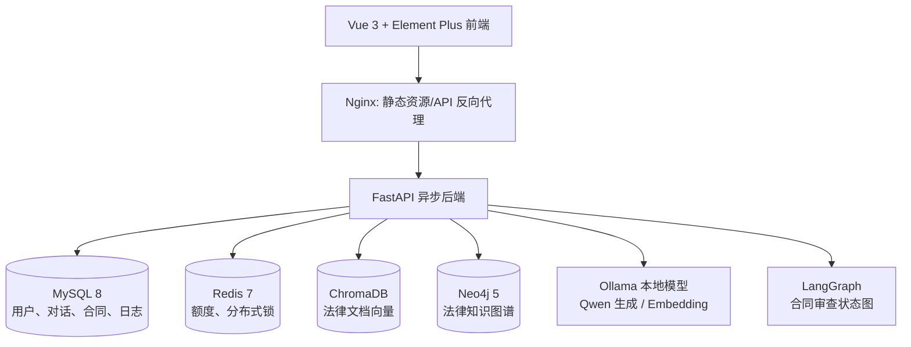
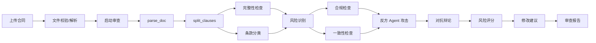

# 智法通：企业级智能法律顾问平台

> 面试项目说明文档｜基于当前仓库实现整理
>
> 项目定位：面向企业法务、业务人员和管理者的本地化智能法律服务平台，提供法律问答、合同审查、知识库检索、知识图谱、经营看板和权限管理能力。

## 1. 一句话介绍

智法通是一个以 **RAG 检索增强生成 + 多 Agent 合同审查** 为核心的企业级法律智能助手。它把企业上传的合同、内置法规和案例样例组织成可检索知识库：用户提问时，系统先检索证据再让本地大模型生成回答并返回引用；上传合同后，则由 LangGraph 编排的多阶段审查工作流识别风险、生成修改建议和审查报告。

## 2. 业务问题与产品边界

企业法务日常会面对三类重复性工作：

1. 业务同事反复咨询常见法律问题，回答难以沉淀、复用和追溯。
2. 合同审查高度依赖人工经验，遗漏风险、审查口径不一致和审查周期长是常见问题。
3. 法规、案例、企业内部制度分散，检索成本高，管理层也缺乏可视化的法律事务数据。

本项目的目标不是替代律师出具正式法律意见，而是作为法律工作流的“第一层助手”：提升信息检索、风险初筛、合同修改建议和数据归纳的效率。问答服务会附加免责声明，界面也将引用、置信度和低置信度提示展示给用户，避免把模型输出包装成确定结论。

## 3. 技术架构



| 层级 | 实现 | 作用 |
| --- | --- | --- |
| 前端 | Vue 3、TypeScript、Vite、Pinia、Vue Router、Axios、Element Plus、ECharts | 单页应用、状态管理、权限路由、图表和交互界面 |
| API | FastAPI、Pydantic、SQLAlchemy Async | 异步 REST/SSE API、参数校验、统一异常处理 |
| AI | Ollama + Qwen、RAG Pipeline、LangGraph | 本地模型推理、检索增强问答、合同审查编排 |
| 数据 | MySQL、Redis、ChromaDB、Neo4j | 业务事实、限额与锁、向量检索、实体关系图谱 |
| 文件 | PyMuPDF、pdfplumber、python-docx | PDF、Word、TXT 解析 |
| 部署 | Docker Compose、Nginx、多阶段构建 | 一键启动和服务健康检查 |

代码入口可从 [后端应用入口](../backend/app/main.py)、[前端路由](../frontend/src/router/index.ts)、[Docker 编排](../docker-compose.yml) 开始阅读。

## 4. 数据集与数据来源

### 4.1 当前仓库中的数据构成

| 数据类别 | 当前来源与位置 | 在系统中的用途 |
| --- | --- | --- |
| 内置法规摘录 | [`backend/app/init_data.py`](../backend/app/init_data.py) 的 `SAMPLE_LEGAL_DOCS` | 首次启动写入 MySQL，随后分块、向量化，供 RAG 问答使用 |
| 法条检索样例 | [`backend/app/mcp_servers/data/law_articles.json`](../backend/app/mcp_servers/data/law_articles.json) | 法条 MCP 检索与 Neo4j 图谱构建 |
| 案例检索样例 | [`backend/app/mcp_servers/data/cases.json`](../backend/app/mcp_servers/data/cases.json) | 案例 MCP 检索与 Neo4j 图谱构建 |
| 用户上传文档 | 知识库上传接口写入 MySQL、上传卷和 ChromaDB | 企业制度、合同模板、法规补充材料等私有知识 |
| 用户业务数据 | 登录、对话、合同、反馈、通知、查询日志 | 审计、看板和分析模块的聚合数据 |

内置种子法规目前包含《劳动合同法》摘录、《民法典》合同编摘录、《消费者权益保护法》摘录和民间借贷司法解释摘录。其文本是公开法律法规的演示性摘录；法条 JSON 与案例 JSON 是仓库内维护的本地样例数据。

### 4.2 面试中必须诚实说明的点

当前仓库没有为 `law_articles.json` 和 `cases.json` 保存逐条的原始网址、抓取时间、授权记录或版本号。因此应表述为：

> “项目内置的是基于公开法律法规文本整理的演示样例，以及用于验证检索和图谱关系的本地案例样例；生产化时需要接入可授权、可追溯的数据源，保存法规版本、生效状态、来源链接和入库时间，并建立更新任务。”

不要说“所有案例都直接来自裁判文书网”或“已经拥有完整权威数据集”，除非后续真的补齐来源、授权和同步链路。这种边界意识本身是法律 AI 项目在面试中值得强调的工程素养。

### 4.3 生产数据治理建议

- 法规：接入国家法律法规数据库或有授权的商业法律数据库；按法律名称、条号、公布/施行日期、效力状态、版本号和来源 URL 入库。
- 案例：只使用具有合法授权和可追溯来源的公开裁判文书或商业数据库；增加脱敏、去重和案件质量分级。
- 企业文档：按租户、部门、密级、有效期建立 ACL；向量检索时携带权限过滤，避免跨租户召回。
- 评测集：维护“问题—标准证据—参考答案—风险等级”集合，分别评测召回率、引用正确率、幻觉率和人工采纳率。

## 5. 核心功能、接口与端到端流程

### 5.1 认证与 RBAC 权限管理

**用户价值**：普通员工只使用问答、合同和知识检索；法务负责人可看企业看板和分析；管理员可管理用户与角色。

**请求链路**：

```text
登录页 → POST /api/v1/auth/login → AuthService 校验 bcrypt 密码
→ 签发 access/refresh JWT → 前端 localStorage 保存 token
→ Axios 请求拦截器添加 Authorization: Bearer token
→ FastAPI get_current_user 解析 JWT → require_permission / 角色判断
→ 返回资源或 401/403
```

**实现细节**：

- 后端认证接口在 [`backend/app/api/auth.py`](../backend/app/api/auth.py)，密码哈希与 JWT 工具在 [`backend/app/utils/security.py`](../backend/app/utils/security.py)。
- MySQL 中保存用户、角色与权限模型；预置 `admin`、`legal_admin`、`user` 三类角色。
- 前端 [`frontend/src/api/index.ts`](../frontend/src/api/index.ts) 统一注入 Bearer Token，并集中处理 401、403、422、500。
- [`frontend/src/router/index.ts`](../frontend/src/router/index.ts) 使用路由 `meta.roles` 做前端体验层拦截；真正的安全边界仍在后端依赖注入。

**值得讲的点**：前后端双层鉴权。前端隐藏无权限入口并重定向，后端再做 token 与权限校验，防止用户直接拼 URL 越权。

### 5.2 法律智能问答（RAG + SSE）

**用户价值**：回答不仅由模型生成，还会结合检索到的法律文本，并返回引用与置信度。

**非流式流程**：

```text
输入问题 → POST /qa/ask → 创建/读取会话与历史消息
→ 指代消解 → 查询改写 → 复杂问题子查询分解
→ 向量检索 + BM25 检索 → RRF 融合 → Cross-Encoder 精排
→ 拼装上下文 → Ollama 生成回答 → 启发式自评估
→ 低置信度时扩大召回范围重检索（最多配置次数）
→ 校验引用 → XSS 清洗 + 追加免责声明 → MySQL 持久化 → 返回回答/引用/置信度
```

**流式流程**：前端调用 `POST /qa/ask/stream`，FastAPI 使用 `StreamingResponse` 返回 SSE；服务端按内容块发送，前端边收边渲染。流结束后再保存完整回答、耗时和引用，保证“首字响应体验”和“审计可追溯”同时成立。

**代码实现细节**：

- API：[`backend/app/api/qa.py`](../backend/app/api/qa.py)，包括问答、流式问答、会话列表、消息历史、反馈、重命名和删除。
- 业务服务：[`backend/app/services/qa_service.py`](../backend/app/services/qa_service.py)，负责创建对话、保存 user/assistant 消息和数据清洗。
- RAG 编排：[`backend/app/rag/pipeline.py`](../backend/app/rag/pipeline.py)。复杂问题才进入子查询分解，避免对所有问题额外调用模型。
- 召回：[`backend/app/rag/retriever.py`](../backend/app/rag/retriever.py) 组合 Chroma 稠密召回、中文分词/BM25 稀疏召回，再用 RRF 融合。
- 精排：[`backend/app/rag/reranker.py`](../backend/app/rag/reranker.py) 优先调用 Cross-Encoder 服务；不可用时有 LLM 回退逻辑。
- 安全：回答在流式和最终入库两个阶段都经过 `sanitize_html_content`，前端 Markdown 渲染使用 DOMPurify。

**值得讲的点**：

1. 不是“LLM 直接回答”，而是“检索—生成—评估—重检索”的闭环。
2. 稠密检索能理解语义，BM25 对法律条号、专有名词和精确关键词更稳，RRF 避免手工归一化不同分数。
3. 低置信度时扩大 `top_k` 并放宽效力过滤再尝试，最终仍低置信度则带警告返回，属于可解释的降级，而不是静默编造。

### 5.3 知识库上传、索引和检索

**用户价值**：将企业制度、合同模板和法律文件变成可检索的私有知识。

**请求链路**：

```text
选择 PDF/DOCX/DOC/TXT → POST /knowledge/upload
→ 保存文件与 LegalDocument 记录 → FileParser 提取正文
→ 按 chunk_size/overlap 切分 → EmbeddingService 批量/逐段向量化
→ ChromaDB 写入向量与元数据 → MySQL 保存 DocumentChunk 与 vector_id
→ 文档状态由 pending → processing → completed/failed
```

搜索时，服务对查询生成向量，携带文档类型过滤条件访问 ChromaDB，并根据 `document_id` 回查 MySQL，返回标题、分块、相似度和元数据。

**实现细节**：

- [`backend/app/services/knowledge_service.py`](../backend/app/services/knowledge_service.py) 负责文档状态机、解析、切块、入库和搜索。
- [`backend/app/utils/file_parser.py`](../backend/app/utils/file_parser.py) 统一处理 PDF/Word/TXT。
- [`backend/app/rag/embedding.py`](../backend/app/rag/embedding.py) 检测 Ollama embedding 服务；不可用时回退本地哈希向量，以“可用性优先”保证演示和基础功能不中断。
- 启动阶段若 Chroma 集合为空，应用会从 MySQL 文档自动重建索引；使用 Redis `SET NX EX` 锁避免多 worker 重复计算 embedding，见 [`backend/app/main.py`](../backend/app/main.py)。

**值得讲的点**：把关系型事实数据与向量索引解耦。MySQL 是文档事实和审计的来源，ChromaDB 是可重建的检索索引；索引丢失不等于业务数据丢失。

### 5.4 合同智能审查（LangGraph 多 Agent）

**用户价值**：上传合同后给出风险条款、风险等级、完整性/合规性/一致性结论、修改建议和可下载的优化文本。

**端到端流程**：



**代码实现细节**：

- 上传 API 在 [`backend/app/api/contract.py`](../backend/app/api/contract.py)，服务在 [`backend/app/services/contract_service.py`](../backend/app/services/contract_service.py)。
- 上传时执行路径遍历防护、扩展名白名单、10MB 大小限制、MIME 与扩展名一致性检查；再解析 PDF/DOCX/DOC/TXT。
- 审查工作流定义在 [`backend/app/agent/workflow.py`](../backend/app/agent/workflow.py)，使用 `StateGraph` 定义 12 个节点，`MemorySaver` 为后续中断恢复预留检查点能力。
- 节点实现在 [`backend/app/agent/nodes.py`](../backend/app/agent/nodes.py)：先拆条款，再完成完整性、风险、合规、一致性检查；随后“反方 Agent”从弱势方角度质疑主审结论，“辩论节点”记录未解决分歧，最后形成风险评分、建议和报告。
- 普通用户的审查额度由 [`backend/app/services/quota_service.py`](../backend/app/services/quota_service.py) 管理，超额返回 429。
- 合同开始审查时先把状态提交为 `REVIEWING`，然后在无数据库长事务的情况下执行耗时 LLM 流程；避免长时间持有 MySQL 行锁造成重复点击/重试时的锁等待超时。
- `POST /contract/optimize` 基于已审查合同和建议生成 Markdown 优化文本；模型失败时按代码设计可回落为原文加修订说明。

**值得讲的点**：

1. LangGraph 的价值是将不可控的 LLM 调用拆成显式状态图，而不是把所有 prompt 串在一个函数里。
2. “反方审查 + 辩论”不等于多个模型神秘投票，而是把风险识别后的质疑、回应和未解决项结构化写入报告，便于人工复核。
3. 在 Agent 长耗时任务前提交数据库状态并释放事务，是 AI 应用很容易被忽略的并发工程细节。

### 5.5 法律知识图谱

**用户价值**：把法规、法条、案例和概念以关系网络展示，帮助用户从单条检索结果扩展到关联法律知识。

**构建流程**：

```text
读取 law_articles.json + cases.json
→ Law / Article / Case / Concept 四类节点
→ HAS_ARTICLE、REFERENCES、MENTIONS、INVOLVES 四类关系
→ Neo4j MERGE 幂等写入
→ /dashboard/graph 返回 ECharts Graph 所需 nodes + links
→ 前端力导向图渲染、悬浮展示节点/关系详情
```

实现位于 [`backend/app/services/graph_service.py`](../backend/app/services/graph_service.py)。若 Neo4j 无法连接，服务会以同一份本地 JSON 在内存中生成图结构，前端仍可展示，从而实现“增强能力可降级、核心页面不中断”。

### 5.6 仪表盘、数据分析和通知

**用户价值**：管理员和法务负责人能看到问答、合同、用户、知识库的总体情况、趋势、热点和活动流。

- [`backend/app/api/dashboard.py`](../backend/app/api/dashboard.py)：概览统计、近期活动、领域分布、趋势和图谱接口。
- [`backend/app/api/analysis.py`](../backend/app/api/analysis.py) + [`backend/app/services/analysis_service.py`](../backend/app/services/analysis_service.py)：基于 `QueryLog`、`CitationStat`、用户、合同和文档表做热点、引用、趋势和用户聚类分析。
- [`frontend/src/views/Dashboard.vue`](../frontend/src/views/Dashboard.vue) 与 [`frontend/src/views/Analysis.vue`](../frontend/src/views/Analysis.vue)：使用 ECharts 渲染趋势、环图和力导向图，组件卸载时销毁实例并监听窗口 resize。
- 通知模块由 [`backend/app/api/notification.py`](../backend/app/api/notification.py) 和 Pinia store 管理，支持未读数、单条已读和全部已读。

### 5.7 用户管理、反馈与系统设置

- 用户管理 API 位于 [`backend/app/api/user.py`](../backend/app/api/user.py)，管理员可分页查询、创建账号、编辑资料、分配角色、启停账号、重置密码和删除账号。
- 问答反馈接口把“有帮助/需改进”持久化为 `QAFeedback`，可被分析模块用于衡量回答质量。
- 设置页提供个人资料、头像和密码等账户能力；头像上传受文件类型、大小和路径安全校验约束。

## 6. 前端实现说明

### 6.1 页面与状态划分

前端使用 Vue 3 Composition API。每个业务页面对应一个 view，通用 UI 被拆为聊天输入、消息气泡、风险条款卡片、风险仪表盘、文件上传和图表包装组件。Pinia 管理用户登录态、问答会话和通知未读数。

关键工程处理：

- Axios 请求/响应拦截器统一添加 Token、处理错误和登录过期。
- Vue Router 动态导入页面，减少首屏加载；守卫根据角色阻止无权限导航。
- 问答回复采用 Markdown + DOMPurify，避免直接把模型文本当 HTML 注入。
- ECharts tooltip、Element Plus tooltip/popover 在全局样式中统一为纸白浮层、深色文字、浅色边框，避免组件 Teleport 后受 scoped 样式影响。
- 前端运行 `npm run type-check` 使用 `vue-tsc --noEmit` 做类型检查；构建通过 Vite 输出静态文件。

### 6.2 这次 UI 重构可作为补充亮点

本次迭代将原来容易造成低对比度的深色/灰底样式调整为“暖白纸感工作台”：输入框保持白底，深色侧边栏与暖灰纸底搭配，所有主按钮、分页、悬浮提示和图表 tooltip 统一高对比度规则。这个过程可以这样表述：

> “我没有只调一个页面的颜色，而是抽取了全局设计 token 和浮层规范；同时针对 Element Plus 与 ECharts 这类会把节点挂到 body 的组件，用全局 class 和强制前景色解决 scoped CSS 无法覆盖的问题，并逐页根据可读性反馈修复主按钮和链接型按钮。”

## 7. 部署、可观测性与容错

### 7.1 Docker Compose 编排

当前 `docker-compose.yml` 启动 MySQL、Redis、Neo4j、FastAPI 和 Nginx 五个服务。

- MySQL、Redis、Neo4j、Chroma 索引和上传文件都通过卷持久化。
- 后端依赖 MySQL/Redis 健康后启动；前端依赖后端健康后启动。
- 前端采用 Node 构建 + Nginx 运行的多阶段镜像；Nginx 代理 `/api` 到 FastAPI。
- 后端暴露 `/health`；服务编排配置 healthcheck，适合继续接入容器编排或监控平台。

### 7.2 已实现的可靠性设计

| 场景 | 处理方式 |
| --- | --- |
| MySQL 初始就绪慢 | 启动生命周期中指数退避重连并幂等建表/灌种子数据 |
| 多 worker 重建索引 | Redis 分布式锁，避免重复 embedding 计算 |
| Chroma/Embedding 不可用 | 向量能力可重建；Embedding 支持本地哈希回退 |
| Neo4j 不可用 | 图谱服务回退内存图结构 |
| Reranker 不可用 | 精排逻辑回退到 LLM 方案 |
| 合同重复审查 | `REVIEWING` 状态防抖，提前提交事务释放行锁 |
| 用户额度耗尽 | quota service 原子检查并返回 HTTP 429 |
| 模型返回不可信 HTML | 服务端清洗、前端 DOMPurify 双层防护 |

## 8. 面试时怎样介绍（60—90 秒版本）

可以直接按下面的话术介绍，再根据面试官追问展开：

> 我做的是智法通，一个面向企业法务的智能法律顾问平台。技术上前端使用 Vue 3、TypeScript、Pinia 和 ECharts，后端是 FastAPI 异步服务，MySQL 存业务数据，Redis 做额度和分布式锁，Chroma 做向量检索，Neo4j 做法律知识图谱，Ollama 部署本地 Qwen 模型。
>
> 项目最核心的是两个场景。第一个是法律问答：我没有让大模型直接回答，而是做了查询改写、复杂问题拆分、向量检索和 BM25 混合召回，再用 RRF 融合和 Cross-Encoder 精排；回答后还会做置信度评估，低置信度时扩大检索范围重试，并返回可追溯引用。第二个是合同审查：我用 LangGraph 把解析、条款拆分、完整性、风险、合规、一致性、反方质疑、辩论、评分和报告生成建成显式状态图。这样结果可以落库、可以审计，也便于后续增加人工确认节点。
>
> 在工程上我重点处理了可用性和安全性，例如 Chroma 索引自动重建加 Redis 锁、Neo4j 和 reranker 的降级、合同长耗时任务不持有数据库事务、JWT + RBAC、文件上传校验以及模型输出的 XSS 清洗。项目通过 Docker Compose 部署，服务都有健康检查。

## 9. 建议重点讲的技术点

### 9.1 RAG 为什么是“两阶段检索”

- 粗排阶段优先保证召回：向量检索解决语义相近，BM25 保证条款号、法名、关键术语不漏。
- RRF 将不同排序来源统一融合，比直接相加分数更稳定。
- 精排阶段用 Cross-Encoder 同时编码 query 和候选文本，牺牲少量计算换取 Top-N 相关性。
- 先召回 20 再精排 5，避免把昂贵精排作用于全量语料。

### 9.2 如何降低法律问答幻觉

- 先检索、后生成，并把证据放入 prompt。
- 输出携带 citations，而不是只给自然语言结论。
- 对低置信度触发重检索闭环，并显式返回 warning。
- 引用校验检查回答中法条是否存在于检索结果；最终附加“非正式法律意见”提示。
- 生产进一步可增加强制“无证据则拒答”、基准评测集和人工复核队列。

### 9.3 为什么合同审查要做多 Agent/状态图

- 合同审查不是一个单一分类任务：完整性、风险、合规和一致性目标不同。
- 将每一步拆成节点，能记录中间结果、独立调试和调整 prompt。
- 反方节点专门寻找主审结论的盲点，辩论节点将分歧结构化为 `unresolved_issues`，提高人工复核效率。
- LangGraph 的 checkpoint 能扩展为“高风险条款人工确认后再继续”的 Human-in-the-loop。

### 9.4 AI 应用的工程细节

- LLM 调用可能几十秒，不能把数据库事务包在外面；先提交状态再运行推理，防止行锁堆积。
- 向量索引属于派生数据，需要可重建、可检测维度变更，并发重建需要分布式锁。
- 降级是完整产品的一部分：模型、图数据库、精排服务不可用时，优先维持基础功能且记录降级状态。
- 对模型输出既要防 prompt/事实风险，也要防 HTML/XSS 风险；后端与前端双重清洗。

## 10. 高频追问与回答思路

| 面试官可能追问 | 回答思路 |
| --- | --- |
| 为什么不用纯向量检索？ | 法律条号、法名和术语是强关键词；BM25 与语义召回互补，RRF 使两类排序更稳。 |
| Chroma 与 MySQL 为什么都要？ | MySQL 保存可审计的源数据和关系；Chroma 仅保存高效 ANN 检索索引，支持重建。 |
| 怎么评估 RAG？ | 分离评估召回命中率、精排 NDCG、引用正确率、答案事实一致性、人工采纳率和 P95 时延。 |
| 多 Agent 真正带来什么？ | 不是为了堆概念，而是让不同检查目标和争议显式化；我会记录中间结论、反方意见和未解决问题供人工审查。 |
| 如何保证法律数据更新？ | 当前仓库是本地样例。生产要接入可授权来源、记录版本/效力/来源链接、做定时增量同步并重建受影响向量。 |
| 如果模型挂了怎么办？ | 返回受控降级或提示；Embedding/图谱/精排已有不同层次回退，不能把虚构答案当成功结果。 |

## 11. 可以继续迭代的方向

1. 多租户与文档 ACL：在 MySQL、Chroma metadata 和 Neo4j 查询中贯彻 tenant_id/department_id 过滤。
2. 异步任务队列：将大文件解析、批量 embedding 和合同审查迁移到 Celery/RQ/Kafka，前端通过 SSE/WebSocket 查询任务进度。
3. 评测与观测：记录每次检索候选、精排分数、prompt 版本、模型耗时和用户反馈，形成可回归的 RAG 评测体系。
4. 数据治理：补齐法规与案例来源、版本、授权和更新任务，建设可审计的数据管线。
5. 生产安全：将示例密码和 JWT 密钥移出 Compose 默认值，接入 Secret 管理、对象存储、审计日志和限流策略。

---

## 阅读路径建议

如果要真正吃透代码，建议按下面顺序：

1. [`docker-compose.yml`](../docker-compose.yml)：先理解服务边界和依赖。
2. [`backend/app/main.py`](../backend/app/main.py)：看应用生命周期、路由注册、索引/图谱初始化。
3. [`backend/app/api/qa.py`](../backend/app/api/qa.py) → [`backend/app/services/qa_service.py`](../backend/app/services/qa_service.py) → [`backend/app/rag/pipeline.py`](../backend/app/rag/pipeline.py)：完整理解 RAG 链路。
4. [`backend/app/api/contract.py`](../backend/app/api/contract.py) → [`backend/app/services/contract_service.py`](../backend/app/services/contract_service.py) → [`backend/app/agent/workflow.py`](../backend/app/agent/workflow.py)：完整理解合同审查。
5. [`frontend/src/router/index.ts`](../frontend/src/router/index.ts) → [`frontend/src/api/index.ts`](../frontend/src/api/index.ts) → 各 view：理解页面、权限和接口调用如何对应。
